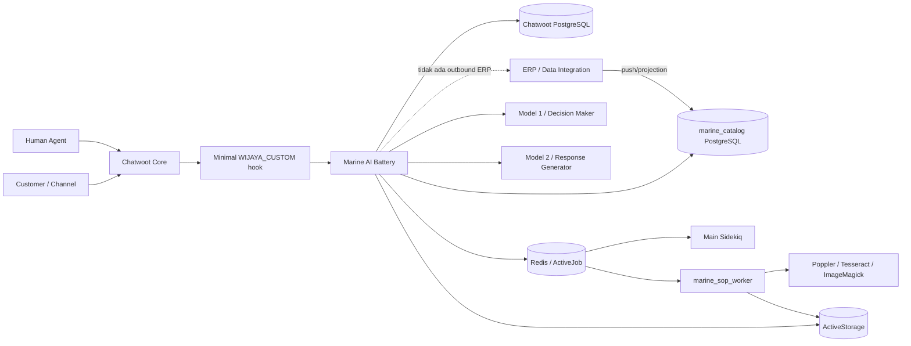
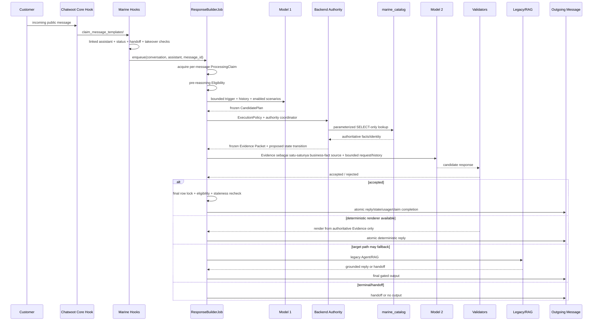
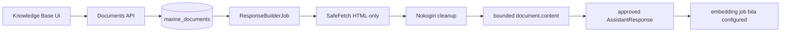
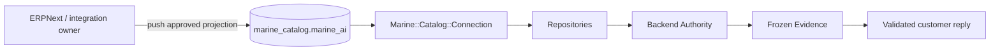
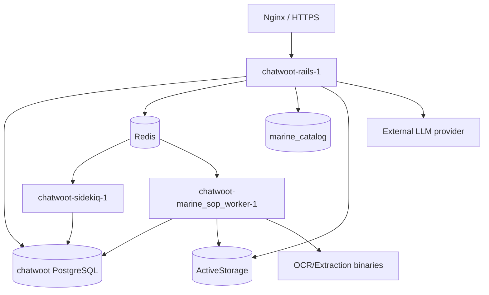

# Marine AI — System & Architecture Saat Ini

> **Status dokumen:** current-state architecture (bukan target design)<br>
> **As-of:** 14 Oktober 2026, 15:04 WIB<br>
> **Source baseline:** branch `devbot`, commit `729c5a832d76d87baeb35e321215e1f09b1e524e`<br>
> **Runtime Dev:** Rails dan Sidekiq menjalankan image `hokgt-chatwoot:devbot-3d40464c2f` dengan embedded SHA yang sama dengan source baseline; HTTP `chatwoot.wijayacorp.com` merespons `200`.<br>
> **Cakupan:** implementasi Marine AI di Chatwoot Dev (`erp-dev`) pada `custom/wijaya/batteries/marine_ai/`, hook core, database, worker, serta UI terkait.

## 1. Ringkasan Eksekutif

Marine AI adalah asisten AI mandiri milik Wijaya yang tertanam di Chatwoot melalui pola **battery + hook-call**. Business logic berada di battery Marine, sementara file core Chatwoot hanya memiliki hook kecil bertanda `WIJAYA_CUSTOM`.

Arsitektur customer reply saat ini mempunyai dua lapisan:

1. **Jalur utama Backend Evidence** — Model 1 memahami intent dan memilih skenario, backend memvalidasi identitas/fakta melalui sumber authoritative, membentuk Evidence Packet beku, lalu Model 2 hanya menyusun presentasi. Jawaban harus lolos validator sebelum dikirim.
2. **Jalur legacy Agent/RAG** — dipakai bila jalur target tidak menghasilkan jawaban deliverable pada kondisi yang memang diizinkan untuk fallback. Jalur ini menangani FAQ/knowledge retrieval, domain guard, product flow lama, dan handoff.

Kapabilitas produk pada jalur Backend saat ini mencakup:

- harga exact variant;
- rentang harga family;
- status stok biner;
- daftar produk;
- informasi produk;
- overview kategori/penawaran perusahaan.

Prinsip pentingnya:

- Model tidak menjadi sumber harga, stok, atau identitas produk.
- Data katalog dibaca dari PostgreSQL `marine_catalog`, schema default `marine_ai`, melalui koneksi SELECT-only terpisah.
- ERP tidak dipanggil keluar oleh Marine. Alur yang diharapkan adalah **ERP mendorong/proyeksikan data ke `marine_catalog`; Marine membaca lokal**.
- Quantity stok mentah tidak keluar dari SQL; Ruby hanya menerima status biner.
- Pada normal trigger-bound path, per-message claim, row lock, eligibility recheck, dan atomic finalization mencegah reply ganda atau reply setelah human takeover; dua-argumen compatibility path lama dijelaskan terpisah di §5.3.
- Memory bersifat advisory, bukan product authority.
- External custom tools/HTTP ERP execution sudah dinonaktifkan; model dan compatibility stubs masih dapat ada, tetapi tidak diekspos sebagai jalur eksekusi.

## 2. Status Bukti dan Interpretasi

Dokumen ini membedakan:

- **CURRENT FACT** — terlihat langsung di source atau runtime.
- **INFERENCE** — kesimpulan teknis dari beberapa komponen; harus divalidasi lagi bila dependency eksternal berubah.
- **RECOMMENDATION** — arah pengembangan, bukan behavior yang sudah aktif.

Tidak ada nama personal yang ditetapkan sebagai owner karena source code tidak menyimpan penanggung jawab organisasi. Pada tabel ownership, role yang disarankan diberi label **perlu ditetapkan organisasi**.

## 3. System Context dan Boundary



### Boundary utama

| Boundary | Status saat ini |
|---|---|
| Chatwoot core → Marine | Satu hook dispatch utama pada message-template flow, ditambah hook UI/serializer/schedule yang kecil dan terdaftar. |
| Marine → ERP | Tidak ada outbound ERP execution. Custom HTTP tools tidak aktif. |
| Marine → catalog DB | Koneksi PG terpisah, read-only session, single parameterized `SELECT`, timeout, error disanitasi. |
| Marine → LLM | Dua konfigurasi model terpisah: Decision Maker dan Response Generator. |
| Marine → customer | Normal trigger-bound path melalui finalization setelah eligibility/staleness/idempotency gate; executable two-argument compatibility path lama tidak memiliki seluruh invariant yang sama. |
| Memory → product facts | Dilarang menjadi authority; hanya advisory personalization dan re-engagement yang digate. |

## 4. Arsitektur Internal

### 4.1 Struktur battery

```text
custom/wijaya/batteries/marine_ai/
├── app/
│   ├── controllers/api/v1/accounts/marine/
│   ├── jobs/marine/
│   ├── models/marine/
│   ├── policies/marine/
│   └── services/marine/
│       ├── agent/          # legacy orchestration + RAG boundary
│       ├── backend/        # Model 1 → authority → Evidence → Model 2
│       ├── catalog/        # product identity, price, stock, listing, flow state
│       ├── cell/           # retrieval/knowledge base
│       ├── charge/         # response generation and inspectors
│       ├── circuit/        # domain guard, handoff, handoff window
│       ├── conversation/   # context, eligibility, claim, delivery
│       ├── copilot/        # agent-facing Ask Marine/composer tasks
│       ├── decision/       # Model 1 contract/client/normalization
│       ├── documents/      # website, SOP/OCR/chunk, product catalog
│       ├── llm/            # provider config/settings/translation/embedding
│       ├── memory/         # idle memory, reader, re-engagement
│       ├── product_authority/ # acceptance/shadow/parity tooling
│       └── provisioning/   # marine_catalog provisioning/privileges
├── frontend/
├── config/locales/
├── deploy/
├── docs/
├── loader.rb
├── patch/
└── routes.rb
```

### 4.2 Core hook touchpoints

CURRENT FACT: touchpoint Marine yang ditemukan mencakup:

- `app/services/message_templates/hook_execution_service.rb` — claim/suppress native templates dan schedule Marine response.
- `app/views/api/v1/models/_inbox.json.jbuilder` — expose `marine_assistant_id` secara fail-open.
- `app/javascript/dashboard/components-next/sidebar/Sidebar.vue` — inject menu Marine.
- `app/javascript/dashboard/routes/dashboard/dashboard.routes.js` — inject routes Marine.
- `app/javascript/dashboard/routes/dashboard/settings/settings.routes.js` — settings route integration.
- `app/javascript/dashboard/components/widgets/WootWriter/*` dan `useCaptain.js` — routing composer/copilot ke Marine pada inbox terhubung.
- `config/schedule.yml` — daily memory checkpoint.

Semua touchpoint harus tetap kecil. Registry utama ada di `custom/wijaya/patches/patch_registry.yml`; reapply/check ditangani oleh script Wijaya.

## 5. Workflow Customer Reply



### 5.1 Trigger dan eligibility

Pada normal trigger-bound path, `Wijaya::Marine::Hooks` hanya menjadwalkan job ketika:

- message incoming;
- inbox terhubung ke `Marine::Assistant`;
- conversation tidak resolved atau snoozed;
- tidak ada active handoff dalam messaging window;
- belum ada public outgoing reply dengan `sender_type='User'`.

Hook precheck belum memeriksa native-app `external_echo`. Sesudah job mulai, `Marine::Conversation::Eligibility` menjadi canonical gate dan mendeteksi human takeover dari public outgoing message oleh `User` **atau** native-app `external_echo=true`. Gate ini menghentikan processing/output walaupun hook sempat enqueue. Assignment/team routing pasif bukan takeover.

Marine tetap menekan native welcome/out-of-office/email-collect template ketika conversation sedang ditangani, agar customer tidak menerima dua automation sekaligus.

### 5.2 Context

`Marine::Conversation::ContextBuilder` membentuk:

- current trigger maksimal 4.000 karakter;
- maksimal 10 public prior turns;
- maksimal 500 karakter per prior turn;
- private notes tidak masuk canonical public history;
- trigger dipisahkan dari history agar tidak dihitung dua kali;
- fresh native messaging window menghapus pre-window history dan menandai interaction sebagai opening;
- memory ditempatkan dalam envelope advisory terpisah.

### 5.3 Idempotency dan finalization

Pada normal tiga-argumen trigger-bound job (`conversation`, `assistant`, `trigger_message_id`), `ProcessingClaim` disimpan dalam:

```text
message.additional_attributes['wijaya_marine_ai']['processing_claim_v1']
```

Claim dibuat/reclaim di bawah row lock Message. Completed claim tidak bisa diproses ulang. Sebelum output, `ResponseBuilderJob` melakukan reload + Conversation row lock, lalu memeriksa kembali:

- eligibility;
- human takeover/handoff;
- newer relevant incoming message;
- transition/evidence contract.

State, outgoing message, usage, dan completion claim dilakukan dalam transaksi finalization yang sama.

Masih ada executable **dua-argumen compatibility path** untuk job lama yang tidak membawa `trigger_message_id`. Path ini tidak memakai `ProcessingClaim`, newer-message staleness check, atau trigger-bound atomic finalization yang sama; current hook tidak menjadwalkan path ini, tetapi job lama/direct caller masih dapat menjalankannya. Karena itu, invariant idempotency/finalization di atas berlaku untuk normal current three-argument enqueue, bukan absolut untuk semua invocation shape.

## 6. Dual-Model dan Product Authority

### 6.1 Model 1 — Decision Maker

Model 1 menghasilkan `CandidatePlan` terstruktur, bukan jawaban customer. Vocabulary saat ini:

- `price`
- `price_range`
- `stock`
- `product_overview`
- `product_listing`
- `product_information`
- `unsupported`

Plan membawa skenario, intent, kandidat slot, language, confidence, dan reason. Output dianggap untrusted dan harus melewati adapter serta `ExecutionPolicy`.

### 6.2 Backend authority

`AuthorityCoordinator`:

1. memvalidasi plan dan scenario;
2. mensyaratkan satu product intent yang diizinkan;
3. meng-ground family/variant/item-group terhadap repository;
4. membaca fakta authoritative;
5. menentukan customer language;
6. membentuk Evidence Packet;
7. mengusulkan state transition yang closed-schema bila diperlukan.

#### Intent dan authority

| Intent | Authority utama | Output utama |
|---|---|---|
| `price` | `item`, `item_price`, `price_list` | exact approved general selling price untuk variant |
| `price_range` | active family children + `item_price` + `price_list` | min/max hanya bila semua active variants punya tuple valid dan currency/UOM homogen |
| `stock` | `bin` | `available`/`unavailable` saja; quantity mentah tidak keluar SQL |
| `product_listing` | `item` | bounded active sellable template listing, dapat scoped ke Item Group |
| `product_information` | catalog identity + approved KB description | hybrid: identity/membership authoritative dari catalog, deskripsi dari approved KB |
| `product_overview` | `item.item_group` projection | kategori/penawaran perusahaan, bukan dump semua item |

### 6.3 Evidence Packet

Sebagian besar capability memakai `marine_evidence_v2`. `answer_price_range` memakai `marine_evidence_v3` karena membawa `presentation_policy` closed-schema:

- tone: `professional|casual|formal`;
- verbosity: `concise|detailed`;
- range follow-up: `ask_variant_code|standalone`.

Packet harus deep-frozen, key-nya tertutup, mempunyai response goal yang valid, timestamp UTC, provenance, constraints, prohibited claims, dan fact set yang cocok dengan goal.

### 6.4 Model 2 dan validation

Model 2 menyusun wording dengan Evidence Packet sebagai **satu-satunya sumber business facts**, bukan sebagai satu-satunya input. Prompt juga menerima bounded current customer request dan bounded message history; Evidence v3 menambah trusted presentation-policy control block. Candidate melewati:

1. `PostGenerationFactValidator`;
2. `PersonaValidator`;
3. `EvidenceFactVerifier` semantic check.

Jika candidate gagal:

| Goal | Behavior saat candidate gagal |
|---|---|
| exact price | deterministic renderer dari Evidence |
| price range | deterministic renderer dari Evidence v3 |
| binary stock | deterministic renderer dari Evidence |
| company offerings / overview | deterministic renderer; invalid target dapat berakhir terminal-no-output |
| product listing | deterministic fallback tersedia pada semantic-verifier rejection setelah fact/persona gate lolos |
| product information | tidak mempunyai generic deterministic description renderer; fail closed/fallback sesuai result policy |

Catatan: komentar historis di beberapa file masih menyebut cakupan lama. Source executable dan test contract harus menjadi acuan, bukan header lama.

### 6.5 Legacy Agent/RAG

Jika target path mengembalikan fallback yang diizinkan, `Marine::Agent::Runner` menjalankan:

1. exact approved FAQ precedence;
2. legacy product orchestration untuk trigger-bound context;
3. domain/security boundary;
4. trusted-memory re-engagement gate;
5. scenario metadata selection;
6. approved knowledge retrieval + response generation;
7. handoff bila tidak aman atau tidak dapat dijawab.

Legacy path tetap aktif, sehingga troubleshooting wajib mencatat `source_type` dan `orchestration_path`. Jangan menganggap semua reply Marine sudah melalui Evidence-v2.

## 7. Knowledge Base dan Document Workflow

### 7.1 FAQ

- Disimpan sebagai `Marine::AssistantResponse`.
- Status `pending` atau `approved`.
- Hanya approved responses yang menjadi retrieval source.
- Search mengutamakan text match; bila tidak ada dan embedding tersedia, memakai nearest-neighbor cosine.
- Perubahan question/answer dapat enqueue embedding update.

### 7.2 Website document



`SyncService` menghapus script/style/nav/footer/ads-like nodes, memilih readable container, normalisasi text, dan membatasi content. Fetch website adalah outbound web fetch, tetapi bukan ERP integration.

### 7.3 SOP/PDF/image

- Upload: PDF/JPEG/PNG, maksimal 2 MiB, signature/MIME/extension divalidasi.
- Exact original bytes disimpan di ActiveStorage tanpa analyzer/preview.
- `Marine::Documents::ProcessJob` berjalan hanya di queue `marine_sop`.
- Dedicated `marine_sop_worker` concurrency 1 melakukan extraction/OCR.
- Success disimpan atomik menggunakan blob ID + opaque run token agar stale/concurrent run tidak menimpa file baru.
- Content difingerprint, di-chunk, direkonsiliasi atomik menjadi approved responses, lalu embedding jobs di-enqueue.
- Raw exception/path/argv/content tidak ditulis ke API; hanya stable error code.

### 7.4 Product Catalog file

Product Catalog file berbeda dari relational `marine_catalog` DB:

- file PDF/JPEG/PNG dilampirkan ke family tertentu;
- satu primary catalog per assistant + family;
- replacement membutuhkan konfirmasi eksplisit;
- file tidak diekstrak menjadi RAG content;
- file dapat dikirim sebagai native attachment saat product flow membutuhkan katalog;
- one-catalog-per-flow marker mencegah pengiriman berulang.

## 8. Catalog Data Flow dan ERP Boundary



### 8.1 Read contract

`Marine::Catalog::Connection`:

- runtime Dev terverifikasi memakai login `marine_catalog_ro`; session `default_transaction_read_only` bernilai `on`;
- memakai `PG.connect` terpisah dari Rails DB pool;
- `SET default_transaction_read_only = on`;
- statement timeout 10 detik dan lock timeout 5 detik;
- hanya menerima satu statement yang diawali `SELECT` dan tanpa semicolon;
- seluruh customer-derived values sebagai bind params;
- maksimal satu retry untuk connectivity errors yang allowlisted;
- log hanya class error, tidak pernah SQL, bind, password, atau connection params.

### 8.2 Tabel yang benar-benar dibaca sekarang

| Tabel schema `marine_ai` | Pembaca | Tujuan |
|---|---|---|
| `item` | family, variant, listing, company offerings repositories | family/variant identity, active templates, Item Group, sellable status |
| `item_variant_attribute` | variant repository | exact attribute → child resolution |
| `item_price` | price dan price-range repositories | approved selling-price tuple |
| `price_list` | price dan price-range repositories | validasi list aktif/selling |
| `bin` | stock repository | collapse `SUM(actual_qty)` menjadi biner di SQL |

CURRENT FACT: price policy yang di-hardcode sebagai business policy adalah hanya `User Price`; tidak ada fallback ke Partner Price/customer-specific list.

### 8.3 Siapa menulis dan siapa membaca

| Aktivitas | Komponen penanggung jawab teknis | Human owner |
|---|---|---|
| ERP → catalog projection | integrasi/data pipeline di luar Marine | **perlu ditetapkan organisasi** (ERP/Data Owner) |
| Catalog schema/ACL | provisioning service + DBA operation | **perlu ditetapkan organisasi** (DBA/Platform) |
| Read product facts | Marine repositories | **perlu ditetapkan organisasi** (Chatwoot/Marine Engineering) |
| Content FAQ/website/SOP | Marine admin UI/API | **perlu ditetapkan organisasi** (Knowledge Owner) |
| Assistant/inbox/provider settings | Marine admin UI/API | **perlu ditetapkan organisasi** (Chatwoot Account Admin) |
| Customer handoff | Chatwoot agent workflow | **perlu ditetapkan organisasi** (Support/Sales Operations) |

## 9. Conversation State, Memory, dan Re-engagement

### 9.1 Product flow state

Marine menyimpan validated family/variant dan marker catalog delivery pada conversation-owned state. Aturan penting:

- authoritative family switch memulai flow baru dan membersihkan variant/catalog marker lama;
- same-family variant follow-up dapat update flow;
- price/stock transition harus terikat ke identity dalam Evidence;
- expired flow hanya dibaca sebagai expired saat planning, bukan dipercaya diam-diam;
- state baru diaplikasikan di finalization transaction, bukan saat reasoning.

### 9.2 Long-term memory

Memory aktif bila `feature_memory` pada assistant aktif.

Workflow:

1. Setelah turn selesai/no-output terfinalisasi, job idle dijadwalkan sesuai `memory_idle_timeout_hours` (1–24 jam, default 2 jam).
2. Dev memiliki operator-only override menit (5–60) yang tidak diekspos UI/API.
3. Daily cron pukul 02:00 Asia/Jakarta menjadi idempotent fallback bila delayed job terlewat.
4. Service hanya menerima conversation open/pending/resolved yang idle, tidak snoozed, mempunyai incoming baru, signal lengkap, tidak sedang handoff/clarification.
5. Provider membuat candidate summary; validator kedua memastikan Bahasa Indonesia, durable, spesifik, dan tanpa dynamic product facts.
6. Memory disimpan sebagai private outgoing Marine note dengan versioned marker/fingerprint.
7. Duplicate range dan stale snapshot no-op.

Memory reader mengambil maksimal lima trusted marked notes untuk contact yang sama dan membungkusnya sebagai advisory historical context. Harga, stok, quantity, lokasi, dan identitas produk saat ini tidak boleh dipercaya dari memory.

### 9.3 Proactive memory re-engagement

Re-engagement hanya mencoba berjalan bila:

- customer kembali pada fresh native messaging window;
- current turn terbukti pure greeting/pleasantry;
- tidak ada exact FAQ precedence;
- tidak ada active product flow;
- trusted memory terbaru masih dalam 30 hari;
- hanya ada satu topic jelas;
- bila topic menyebut product, product family harus divalidasi ulang ke catalog.

Wording dibuat dinamis oleh provider, lalu diperiksa untuk language, price claim, control leak, dan semantic equivalence. Jika salah satu gate gagal, sistem jatuh ke generic greeting/help path, bukan memaksa memory mention atau handoff.

## 10. Feature Inventory

| Fitur | Status | Catatan |
|---|---|---|
| Autonomous customer reply | **Active** | Trigger-bound job + final delivery gates. |
| Dual-model product authority | **Active** | Model 1 decision, backend authority, Model 2 presentation. |
| Exact price | **Active** | `User Price`, deterministic fallback. |
| Family price range | **Active** | Evidence v3 + presentation policy + deterministic fallback. |
| Binary stock | **Active** | No raw quantity exposure + deterministic fallback. |
| Product listing | **Active** | Bounded template listing; semantic-rejection deterministic fallback. |
| Product information | **Active/Hybrid** | Catalog identity + approved KB description. |
| Company offerings/overview | **Active** | Item Group authority + deterministic renderer. |
| FAQ management/retrieval | **Active** | pending/approved workflow. |
| Website KB sync | **Active** | SafeFetch HTML + text extraction. |
| SOP PDF/image OCR + indexing | **Active, separate worker** | Runtime worker currently uses older embedded SHA; lihat §12. |
| Product Catalog file delivery | **Active** | Primary per family, native attachment, one per flow. |
| Scenarios | **Active** | Routing/classification; external tool references disabled. |
| Ask Marine | **Active** | Agent-facing threads/messages, scoped account+assistant+user. |
| Composer tasks | **Active** | reply suggestion, rewrite, summarize, translate, follow-up. |
| Playground | **Active** | Read-only preview; behavior dapat berbeda dari customer Evidence path. |
| Guardrails/guidelines UI | **Active with partial consumption** | Legacy RAG lebih luas; Backend hanya memproyeksikan subset policy untuk price range. |
| Long-term memory | **Active** | Idle private-note checkpoint, append-only/idempotent. |
| Proactive re-engagement | **Active, narrow gate** | Fresh window + pure greeting + one recent topic. |
| Catalog provisioning UI/API | **Active admin surface** | Privilege lifecycle; credential display harus one-time/safe. |
| Custom HTTP tools / outbound ERP | **Disabled/inert** | Jangan re-enable tanpa architecture/security approval. |
| Product-authority shadow/parity | **Present; default-off/test/acceptance oriented** | Tidak boleh mengubah primary reply saat off. |

## 11. UI dan Pengaturan

### 11.1 Sidebar dan permission

Semua authenticated `administrator` dan `agent` dapat mengakses:

- **FAQs**
- **Knowledge Base**
- **Scenarios**
- **Ask Marine**
- **Playground**

Administrator-only (sidebar disembunyikan dan route guard tetap memblokir direct navigation):

- **Inboxes**
- **AI Provider**
- **Settings**
- **Guardrails**
- **Response Guidelines**

### 11.2 UI page inventory

| UI | Fungsi | Backend/storage |
|---|---|---|
| FAQs | create/edit/delete/approve/search FAQ | `marine_assistant_responses` |
| Knowledge Base | website URL/content, SOP upload/reprocess, Product Catalog upload/replace/delete | `marine_documents`, ActiveStorage, responses/chunks |
| Scenarios | CRUD enabled scenarios | `marine_scenarios` |
| Ask Marine | agent copilot threads, search/query | `marine_copilot_threads/messages` |
| Playground | multi-turn preview + signed ephemeral product state | `/assistants/:id/playground`; tidak persist customer Message |
| Inboxes | connect/disconnect assistant ke inbox | `marine_inboxes` |
| AI Provider | Decision Maker dan Response Generator config/test | Marine-specific InstallationConfig melalui `SettingsStore` |
| Settings | assistant basic/system, feature toggles, status, provisioning, delete | assistant columns/config + account preferences |
| Guardrails | manage guardrail array | `marine_assistants.guardrails` |
| Response Guidelines | manage guideline array | `marine_assistants.response_guidelines` |

### 11.3 Assistant Settings control map

| Control UI | Persisted key | Konsumen nyata saat ini | Catatan operasional |
|---|---|---|---|
| Name | assistant `name` | UI, sender/payload label | Active. |
| Description | assistant `description` | UI/metadata | Jangan anggap otomatis sebagai prompt utama. |
| Product Name | `config.product_name` | terutama Copilot presentation | Tidak menjadi catalog authority. |
| Memory Idle Timeout | `config.memory_idle_timeout_hours` | idle summary scheduler/service | 1–24 jam; default 2. |
| Allow Conversation FAQs | `config.feature_faq` | tersimpan; konsumsi customer pipeline tidak sejelas approved-response gate | Perlu UX/contract audit sebelum dijadikan safety switch. |
| Allow Memories | `config.feature_memory` | memory writer/reader/re-engagement | Active. |
| Allow Contact Attributes | `config.feature_contact_attributes` | tersimpan; consumer utama tidak terlihat pada jalur product authority | Jangan overclaim. |
| Handoff Message | `config.handoff_message` | `HandoffService` | Active. |
| Resolution Message | `config.resolution_message` | tidak terbukti sebagai consumer utama current customer pipeline | Potensi inert/legacy. |
| Instructions | `config.instructions` | legacy RAG, Copilot; subset tone/verbosity diproyeksikan untuk price-range Evidence v3 | Tidak bebas mengubah fakta backend. |
| Temperature | `config.temperature` | legacy/config surface; Evidence generator memakai kebijakan sendiri | Jangan menganggap slider mengontrol semua output. |
| Guardrails | `guardrails[]` | legacy RAG/control path | Backend Evidence tidak memasukkan raw guardrail text. |
| Response Guidelines | `response_guidelines[]` | legacy RAG; keyword subset memengaruhi price-range verbosity policy | Raw guideline tidak menjadi Evidence fact. |
| Language | `config.language` | last-resort operating language pada resolver | Current UI form tidak menampilkan field eksplisit pada halaman Settings ini. |

### 11.4 AI Provider

Dua card independen:

1. **Decision Maker** — provider, model, endpoint, API key, API mode (`chat_completions` atau OpenRouter Decisions sesuai provider).
2. **Response Generator** — provider, model, endpoint, API key; chat-completions only.

Provider yang diregistrasi UI/backend: OpenAI, OpenRouter, Gemini, Anthropic, dan Custom OpenAI-compatible. API key tidak dikembalikan plaintext; hanya masked preview/presence. Test connection dan save hanya administrator.

Penting: mengubah provider/model adalah perubahan runtime behavior walaupun tanpa deploy code. Wajib test connection, smoke representative scenarios, cek latency/rate limit, dan pastikan embedding support sesuai provider.

## 12. Runtime dan Deployment Topology



CURRENT FACT runtime Dev saat dokumen dibuat:

| Service | Image | Embedded SHA | Status |
|---|---|---|---|
| Rails | `hokgt-chatwoot:devbot-3d40464c2f` | `729c5a832d76d87baeb35e321215e1f09b1e524e` | running; HTTP 200 |
| Main Sidekiq | sama dengan Rails | sama dengan source HEAD | running |
| SOP worker | `chatwoot-wijaya:devbot-2a64fc0f5-sop` | `2a64fc0f57ef60713a7dadebb084f8194bc95b91` | running, tetapi lebih lama dari Rails/Sidekiq |
| PostgreSQL | `pgvector/pgvector:pg16` | n/a | running |
| Redis | `redis:alpine` | n/a | running |

Image tag Rails/Sidekiq tidak sama dengan embedded Git SHA karena tag merupakan nama artifact build/deploy, sedangkan `/app/.git_sha` membuktikan source yang tertanam. Verifikasi runtime harus memakai keduanya.

Compose config Rails/Sidekiq hanya menunjuk tracked `/home/stef/chatwoot/docker-compose.deploy.yaml`; tidak ada ketergantungan `/tmp` yang terlihat pada runtime ini.

SOP worker adalah optional overlay dengan queue `marine_sop`, concurrency 1, no-new-privileges, capability drop, PID/memory/tmpfs limits. Drift SHA worker terhadap Rails/Sidekiq adalah operational debt: jangan otomatis menyimpulkan defect, tetapi setiap perubahan SOP harus membangun dan deploy image SOP yang selaras.

> **Peringatan current-running:** uraian pipeline SOP pada §7.3 mengikuti source `devbot` baseline. Sampai worker dibangun ulang dan direcreate, proses `marine_sop` yang benar-benar berjalan mengeksekusi source commit `2a64fc0f57ef60713a7dadebb084f8194bc95b91`, bukan seluruh improvement pada baseline `729c5a8`. Dengan kata lain, source dan runtime SOP saat ini tidak identik. Lebih penting lagi, label Compose container aktif masih menunjuk `docker-compose.production.yaml` plus retired overlay **custom/wijaya/batteries/marine_ai/deploy/docker-compose.marine&#45;sop.yml** (entity ditulis demikian agar deployment-contract scanner tidak menganggapnya referensi aktif); file overlay kedua sudah tidak ada di checkout saat ini. Overlay tracked penggantinya adalah `deploy/docker-compose.marine-sop-worker.yml`. Jadi active stack worker tersebut **tidak bisa direcreate verbatim dari provenance label-nya** tanpa menerjemahkan ke overlay current dan rebuild image dari commit current.

## 13. Security, Safety, dan Failure Behavior

### Safety controls aktif

- account/assistant/inbox relationship validation;
- administrator-only config routes;
- closed intent and packet schemas;
- repository-grounded product identity;
- read-only catalog connection;
- parameterized SQL;
- binary-only stock exposure;
- bounded context, output, upload, chunks, and API payloads;
- SSRF-safe `SafeFetch` untuk website documents;
- API key masking dan blank-key preservation;
- per-message claim dan stale reclaim;
- pre- dan post-reasoning eligibility;
- Conversation row lock dan atomic finalization;
- human takeover precedence;
- fail-closed domain/security and model validation;
- sanitized errors/logging;
- SOP dedicated worker and stale-run fingerprint/run-token guards;
- trusted versioned memory markers + duplicate fingerprint.

### Failure behavior

| Failure | Expected behavior |
|---|---|
| Catalog unconfigured/unreachable | sanitized unavailable; handoff/fallback sesuai capability, tidak mengarang fakta |
| Model 1 malformed/low confidence | plan ditolak; fallback/terminal sesuai contract |
| Model 2 gagal/rejected | deterministic renderer bila tersedia; selain itu fail closed |
| Human reply saat reasoning | final eligibility menghentikan output |
| Duplicate job/webhook | processing claim mencegah reply kedua |
| Newer incoming message | stale job diselesaikan tanpa output |
| SOP extraction failure | stable error code; existing good content dipertahankan bila ada |
| Memory generation error | no-op; tidak memblokir customer reply |
| Re-engagement uncertainty | generic path, tidak menyebut remembered topic secara paksa |

## 14. Known Gaps dan Technical Debt

### CURRENT FACT / VERIFIED FROM SOURCE

1. **Dual architecture masih ada.** Evidence target berjalan sebelum legacy, tetapi legacy Agent/RAG belum dihapus.
2. **Playground bukan bukti sempurna customer path.** Ia menjalankan source-less preview/legacy product preview dan signed ephemeral state, bukan seluruh delivery/claim/finalization flow customer.
3. **Settings consumption tidak seragam.** Beberapa control memengaruhi legacy/Copilot lebih besar daripada Evidence path; subset instructions/guidelines baru diproyeksikan untuk price-range policy.
4. **Product information bersifat hybrid.** Catalog authoritative untuk identity/membership, tetapi deskripsi bergantung pada approved KB content governance.
5. **SOP worker runtime lebih lama dari Rails/Sidekiq.** Perubahan terbaru non-SOP tidak otomatis berarti worker salah, tetapi artifact drift harus dikelola.
6. **Komentar lama masih ada.** Beberapa header menyebut lima capability atau scope lama walau code sudah menambah `product_overview` dan renderer baru.
7. **External custom-tool files/model compatibility masih ada tetapi execution/routes tidak aktif.** Dead compatibility surface perlu tetap jelas agar tidak dianggap fitur aktif.
8. **Owner manusia belum dikodifikasi.** Data freshness, content approval, provider operation, dan escalation ownership perlu RACI organisasi.

### INFERENCE YANG PERLU DIUJI BERKALA

- freshness dan completeness projection ERP → `marine_catalog`;
- actual privilege set pada catalog roles setelah infra change;
- real channel delivery (WhatsApp/API inbox) setelah token/provider/channel change;
- behavior model pada representative stateful conversations;
- queue latency dan OCR capacity pada beban aktual;
- current embedding coverage setelah provider switch.

## 15. Forward-Development Change Map

| Jika ingin mengubah… | Lokasi utama | Hal wajib diperhatikan |
|---|---|---|
| Intent/routing Model 1 | `services/marine/decision/`, `backend/execution_policy.rb` | single primary intent; schema/normalizer/client parity; fail closed; test ambiguous/multi-intent. |
| Fakta harga/range/stok | `services/marine/catalog/*_repository.rb`, planner, packet builder | bind params, SELECT-only, exact policy, no raw quantity, evidence/renderer/verifier parity. |
| Listing/Item Group/company offerings | listing repository, scope resolver, authority coordinator | template vs standalone predicate, bounded page, completeness, no hardcoded family names. |
| Wording Model 2 | evidence prompt/generator/presenter/validators/renderers | Model 2 presentation-only; packet closed; deterministic fallback; control leak/persona/fact verification. |
| Conversation state/follow-up | product flow state store, state transition adapter, exact customer execution | preserve family/variant across valid follow-up; clear stale variant on authoritative family switch; atomic apply only in finalize. |
| FAQ/RAG | `cell/`, `charge/`, AssistantResponse | approved-only, citation/confidence, no product numeric authority from RAG. |
| Website KB | documents sync service/job/UI | SSRF, content type, bounded extraction, safe re-sync/error codes. |
| SOP/OCR | documents/sop, ProcessJob, ResponseBuilderJob, SOP worker overlay | binary preservation, resource limits, stale run guards, chunk fingerprint, dedicated queue/image. |
| Product Catalog attachment | document model/service/selector/delivery | one primary per family, explicit replace, no RAG extraction, one delivery per flow. |
| Memory | `services/marine/memory/`, idle/checkpoint jobs, settings UI | append-only/idempotent, idle not resolve-triggered, private notes, no dynamic product facts, privacy/retention policy. |
| Re-engagement | `memory/reengagement/`, Agent Runner seam | fresh window, pure greeting, single recent topic, catalog revalidation, generic fallback. |
| UI settings | battery frontend + controllers/models | map each control to actual consumer; admin route + sidebar parity; avoid misleading/inert control. |
| LLM providers | `llm/provider_config`, settings store/controller/UI | key masking, endpoint validation, target-specific modes, embedding support, connection test, migration compatibility. |
| New core integration | minimal core hook + battery API | `WIJAYA_CUSTOM_START/END`, same feature name, registry entry, idempotent apply/check scripts. |
| DB schema | migrations + model/service/spec | backup when applied to runtime, reversible/safe migration, foreign-key deletion lifecycle, schema verification. |
| Deployment | Dockerfile/compose/deploy scripts | exact image SHA, Rails/Sidekiq/SOP worker alignment, migration order, manifest persistence, HTTP/queue/log smoke. |

### 15.1 Aturan perubahan arsitektur

1. Jangan menaruh business rule Marine langsung di core Chatwoot.
2. Core hanya mengumpulkan context minimum dan memanggil stable battery API.
3. Semua battery/custom file dan hook touchpoint harus terdaftar.
4. Jika hook berpindah setelah upstream merge, update registry + apply/check scripts dan verifikasi seluruh battery tetap wired.
5. Jangan menambah direct ERP HTTP access. Gunakan projection ke `marine_catalog` dengan role terpisah.
6. Jangan menjadikan model/memory/RAG sebagai price/stock/product-identity authority.
7. Jangan membuka exact stock quantity tanpa keputusan produk/security baru dan redesign Evidence contract.
8. Jangan hardcode product ID/family/phrase sebagai shortcut intent.
9. Jangan mengubah Evidence fact tanpa mengubah builder, presenter, validator, semantic verifier, renderer, dan tests sebagai satu contract.
10. Jangan menyatakan UI working hanya karena API/source ada; lakukan browser/network/runtime proof.

## 16. Definition of Done untuk Pengembangan Berikutnya

### Code/architecture

- [ ] Perubahan berada di battery yang benar.
- [ ] Core hook minimal dan marker benar.
- [ ] Registry serta apply/check script konsisten bila touchpoint/file battery berubah.
- [ ] Tidak ada business fact baru berasal dari LLM/memory/RAG.
- [ ] Backward compatibility terhadap current messages/jobs/state diperiksa.

### Data/safety

- [ ] Source of truth dan writer/reader jelas.
- [ ] Account scoping dan permission diuji.
- [ ] SQL parameterized + read-only contract dipertahankan.
- [ ] Failure path fail closed dan tidak bocorkan secret/customer content.
- [ ] Idempotency, stale/concurrent execution, dan retry diuji.

### Testing

- [ ] Targeted unit/service/controller/frontend tests.
- [ ] Contract tests untuk schema/evidence/transition/settings consumption.
- [ ] Integration test dengan test-database safety wrapper.
- [ ] Browser proof untuk perubahan UI.
- [ ] Synthetic/reversible runtime smoke; jangan gunakan customer conversation identifiers.

### Deployment

- [ ] Commit dan push ke `origin devbot`.
- [ ] Build exact-commit image dan verifikasi embedded SHA.
- [ ] Update tracked compose/overlay secara durable.
- [ ] Recreate service yang relevan.
- [ ] Verifikasi Rails, Sidekiq, dan SOP worker bila tersentuh.
- [ ] HTTP 200, queue health, restart count, log errors, dan feature smoke.
- [ ] Untuk production, PR/handoff terpisah; jangan merge/deploy tanpa otorisasi owner.

## 17. Evidence Appendix

### Source paths utama

- `custom/wijaya/batteries/marine_ai/app/jobs/marine/conversation/response_builder_job.rb`
- `custom/wijaya/batteries/marine_ai/app/services/wijaya/marine/hooks.rb`
- `custom/wijaya/batteries/marine_ai/app/services/marine/conversation/`
- `custom/wijaya/batteries/marine_ai/app/services/marine/decision/`
- `custom/wijaya/batteries/marine_ai/app/services/marine/backend/`
- `custom/wijaya/batteries/marine_ai/app/services/marine/catalog/`
- `custom/wijaya/batteries/marine_ai/app/services/marine/agent/runner.rb`
- `custom/wijaya/batteries/marine_ai/app/services/marine/cell/`
- `custom/wijaya/batteries/marine_ai/app/services/marine/charge/`
- `custom/wijaya/batteries/marine_ai/app/services/marine/circuit/`
- `custom/wijaya/batteries/marine_ai/app/services/marine/documents/`
- `custom/wijaya/batteries/marine_ai/app/services/marine/memory/`
- `custom/wijaya/batteries/marine_ai/frontend/`
- `custom/wijaya/batteries/marine_ai/routes.rb`
- `custom/wijaya/batteries/marine_ai/deploy/`
- `custom/wijaya/patches/patch_registry.yml`
- `config/schedule.yml`

### Runtime checks yang dipakai

```text
git remote -v
git branch --show-current
git status --short
git log --oneline -5
git rev-parse HEAD
git rev-parse origin/devbot
docker ps
docker inspect <rails/sidekiq>
docker exec <container> cat /app/.git_sha
curl https://chatwoot.wijayacorp.com/
```

### Catatan verifikasi dokumen

Dokumen ini adalah audit source/runtime dan tidak menjalankan full application test suite. Status fitur diambil dari wiring, routes, services, jobs, models, frontend, dan runtime service state. Setiap perubahan selanjutnya tetap wajib menjalankan targeted tests dan runtime verification yang relevan.
